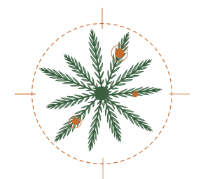
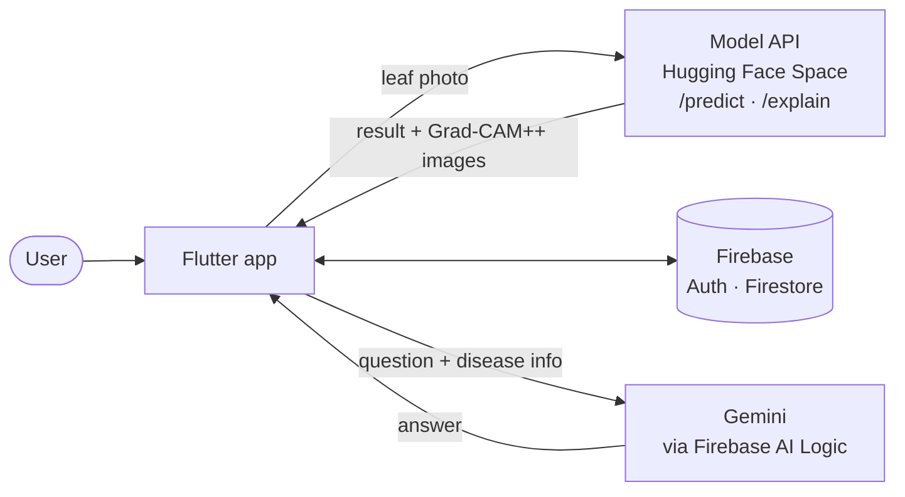

<div align="center">

<picture>
  <source media="(prefers-color-scheme: dark)" srcset="assets/images/logo_light.png">
  
</picture>

# Sa'af (سعف)

**An Explainable Hybrid CNN-Transformer Model for Date Palm Disease Classification**

A Flutter mobile app that diagnoses date palm leaf diseases from a photo
and shows which parts of the leaf the AI based its decision on.


</div>

---

## Overview

Date palms are one of the most important crops in Saudi Arabia, and diseases that are not caught early can damage the tree and reduce its yield. Identifying a disease usually requires an expert's inspection, which is not always quickly available.

**Sa'af** brings our research model out of the notebook and into a mobile app. The user takes or uploads a photo of a palm leaf, and the app:

1. decides whether the leaf is **healthy or diseased**,
2. identifies the **specific disease** among eight classes, with a confidence score,
3. shows a **Grad-CAM++ heatmap** of the areas the model focused on, and
4. lets the user ask an **AI chatbot** about the diagnosis and its treatment.

This app is the prototype of our graduation project (CSC 496/497).

## Features

**Diagnosis**
- Capture a photo with the camera or pick one from the gallery
- Healthy / diseased result, the predicted disease, and a confidence score
- The top model predictions shown as bars
- A warning that asks the user to retake a clearer photo when the model's confidence is low
- Description, symptoms, and recommended treatment for the detected disease, loaded from the database

**Explainable AI**
- A Grad-CAM++ **Heatmap** view and a **Region** view that outlines the high-attention areas of the leaf

**AI chatbot**
- Ask questions about a scan, such as how to treat the disease
- Answers are grounded in the disease information stored in Firestore (description, symptoms, treatment); the bot is instructed not to invent treatments that are not in it
- Replies in Arabic or English, following the language of the user's message
- Conversations are saved and can be reopened later

**History and Home**
- Every scan is saved with its photo and explanation images
- Search by disease name, filter by *All / Healthy / Diseased*, and delete scans
- The Home screen shows the number of healthy, diseased, and total scans, plus the most recent diagnoses

**Account**
- Sign up, log in, password reset by email, and **guest mode**
- Edit profile, change password (with a strength indicator), log out
- Delete account, which also deletes the user's scans and chats
- Each user can only access their own data

## Detected Classes

| # | Class | # | Class |
|:-:|---|:-:|---|
| 1 | Potassium Deficiency | 6 | Fusarium Wilt |
| 2 | Manganese Deficiency | 7 | Rachis Blight |
| 3 | Magnesium Deficiency | 8 | Parlatoria Blanchardi |
| 4 | Black Scorch | 9 | Healthy |
| 5 | Leaf Spots | | |

## The Model

A dual-branch hybrid model that combines a CNN and a Transformer, running in parallel:

| Component | Role |
|---|---|
| **EfficientNetV2-S** | Extracts local texture features (spots, discoloration) |
| **Swin-Tiny Transformer** | Captures global spatial patterns across the leaf |
| **Bidirectional cross-attention fusion** | Lets each branch attend to the other's features |
| **Dual-head classifier** | Head A: healthy vs. diseased · Head B: one of the 8 diseases |

It was trained and evaluated on the **Madinah Date Palm Dataset** and compared with VGG16, DenseNet121, MobileNetV3-Large, ResNet18, and each branch on its own, all under the same training protocol.

**Test results**

| Accuracy | Macro-F1 | Recall | Precision |
|:-:|:-:|:-:|:-:|
| **97.34%** | **94.41%** | **94.96%** | **93.98%** |

In the research, three explainability methods were studied: **Grad-CAM++**, **cross-attention pooling maps**, and **LIME**. The app uses Grad-CAM++ for its heatmap and region views.

## System Architecture



| Layer | Technology |
|---|---|
| Mobile app | Flutter (Dart) |
| Authentication | Firebase Authentication (email/password and anonymous guest) |
| Database | Cloud Firestore |
| Model serving | PyTorch model behind a REST API on Hugging Face Spaces |
| Chatbot | Google Gemini through Firebase AI Logic |

The model server is hosted separately and is not part of this repository.

## Database

| Collection | Contents |
|---|---|
| `users/{uid}` | Name, email, and scan counters (total, healthy, diseased) |
| `users/{uid}/scans/{scanId}` | Result, confidence, top predictions, the photo, and the explanation images |
| `users/{uid}/chats/{chatId}` | A chatbot conversation, optionally linked to a scan |
| `users/{uid}/chats/{chatId}/messages/{id}` | The messages of a conversation |
| `diseases/{diseaseId}` | Description, symptoms, and treatment of each class |

Images are stored as Base64 inside the scan document, so no Firebase Storage is needed. The explanation images are resized and compressed to stay within Firestore's 1 MB document limit.

## Project Structure

```
lib/
├── main.dart                     # App entry, splash, onboarding, login
├── create_account.dart           # Sign up
├── home_page.dart                # Home dashboard
├── scan_page.dart                # Camera / gallery and sending the photo to the model
├── analysis_result_screen.dart   # Diagnosis, explanation, disease info, saving the scan
├── History.dart                  # Scan history and scan details
├── chatbot.dart                  # Chatbot screen
├── services/
│   ├── auth_service.dart         # Firebase Authentication and account management
│   ├── model_service.dart        # Calls the model API (/predict, /explain)
│   └── chat_service.dart         # Gemini chatbot grounded in Firestore data
├── settings/                     # Settings, edit profile, change password, about, help
├── theme/app_colors.dart         # App colors
└── widgets/                      # Bottom navigation bar and shared auth widgets
```

## Getting Started

**Requirements:** a recent stable Flutter SDK (Dart 3.11 or newer), Android Studio with an emulator or an Android phone, and an internet connection (the model and the chatbot run online).

```bash
git clone https://github.com/MahaBinDakhil/Saaf-Graduation-Project.git
cd Saaf-Graduation-Project
flutter pub get
flutter run
```

> On Windows, turn on **Developer Mode** before building.

## Limitations

- The app is a research prototype, not a commercial product.
- It analyzes **leaf images only**; it does not consider soil, irrigation, or other factors.
- An internet connection is required.
- The diagnosis is a preliminary assessment. Users should consult an agricultural specialist before applying any treatment.

## Team

| Name |
|---|
| Anfal Alobeid |
| Maha bin Dakhil |
| Maram Alkhamis |
| Raghad Alessa |
| Batool Bamuqabel |

**Supervisor:** Dr. Nouf AlShenaifi

Computer Science Department · College of Computer and Information Sciences
